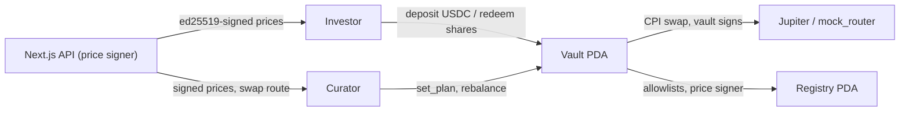

# Folio Lab

**Pooled portfolios of tokenized US stocks on Solana.**

A curator opens a vault and publishes, on-chain, a plan for what they intend to buy. Investors deposit USDC and receive vault shares. The curator invests the pooled USDC in tokenized stocks through an allowlisted swap program (Jupiter on mainnet; a mock router on devnet).

Built for the Solana track: an Anchor program in Rust, a Next.js app, and devnet mock tokens that stand in for xStocks.

| | |
|---|---|
| Live app | _Vercel URL: to be added_ |
| Cluster | Solana devnet (mock stock tokens and mock router) |
| Program | `folio_vault` — [`9PY9RRXQuMtHXDyvWNL5ohFrsSux5SLrJhhdtuBgLUJH`](https://explorer.solana.com/address/9PY9RRXQuMtHXDyvWNL5ohFrsSux5SLrJhhdtuBgLUJH?cluster=devnet) (devnet) |
| Stack | Rust + Anchor 1.2.1 · LiteSVM tests · Next.js 16 + React 19 |

## What the program guarantees

- **The curator can trade but can never withdraw.** A trade swaps one allowlisted token for another through an allowlisted swap program. The vault signs for the swap, then checks every held balance and that no vault token account gained a delegate, a close authority or a new owner.
- **Each trade can lose at most 2%.** Both sides are valued at signed prices; the trade reverts if the value bought is below 98% of the value sold.
- **Withdrawals never close.** Any holder can redeem their share of every holding at any time, even while the vault is paused. A frozen token can be forfeited so it never blocks exit.
- **Deposits never dilute existing holders.** New shares are priced from the vault's full holdings using backend-signed prices (ed25519, at most 60 s old), rounded in favour of existing holders.
- **The plan is public.** `set_plan` stores the curator's plan as free text with a version number. A plan must exist before the first trade, and every `Rebalanced` event records the plan version.
- **Shares cannot be transferred.** They live in a per-investor `Position` account, not a token.

## How it works



1. **Create.** Anyone calls `create_vault` and names a manager (the curator).
2. **Seed and activate.** The first deposit (`seed`, at least 10 USDC) sets 1 share = 1 USDC; the guardian then activates the vault.
3. **Plan.** The curator posts the plan (`set_plan`). Investors see it on the vault page.
4. **Deposit.** The app fetches signed prices from `/api/prices` and sends an Ed25519 verify instruction followed by `deposit` in one transaction.
5. **Rebalance.** The curator console gets a swap route from `/api/trade` and prices from `/api/prices`, then sends `rebalance`.
6. **Redeem.** Holders burn shares and receive their percentage of each held token directly.

Why prices are signed off-chain: these stock tokens have no reliable on-chain price yet. The backend reads market prices, refuses to sign a token that is not trading or whose price is more than 2% from the underlying stock, and signs the update; the program checks the signature through the Ed25519 program.

## Repository

| Path | What |
|---|---|
| `anchor/` | Anchor workspace: `folio_vault` and `mock_router` programs, LiteSVM tests. See [`anchor/README.md`](anchor/README.md). |
| `app/api/` | Route handlers: `/api/prices`, `/api/trade`, `/api/vaults`, `/api/history` |
| `lib/binance/` | Binance Web3 API client (price source) |
| `lib/solana/` | IDLs, PDAs, signed-price helpers, cluster config and deployed addresses |
| `lib/contracts/` | Wallet adapter wrapper and React hooks (deposit, withdraw, balances) |
| `scripts/` | `setup-solana.ts` (tokens, registry, demo vault) and `smoke-solana.ts` (end-to-end check) |
| `app/page.tsx`, `components/` | Investor app: vault list, vault page, deposit, withdraw |
| `app/curator/`, `components/curator/` | Curator console: create, seed, plan, rebalance |
| `docs/` | Product requirements |

## Run it locally

Requirements: Node 24, Rust (via `rustup`), Solana CLI and Anchor 1.2.1 (`brew install solana anchor`), and `cargo-build-sbf` from the [Agave release](https://github.com/anza-xyz/agave/releases).

```bash
npm install
cp .env.example .env.local     # see the comments in it for every value
```

### Programs

```bash
cd anchor
anchor build --arch v0
cargo test -p folio_vault      # full flow + refusal cases, no validator needed
```

### Local validator (no devnet SOL needed)

```bash
npm run validator                              # terminal 1: programs preloaded
solana -u localhost airdrop 100                # terminal 2
CLUSTER=localnet npm run setup:solana          # mock tokens, registry, demo vault → lib/solana/addresses.json
npm run dev                                    # with NEXT_PUBLIC_SOLANA_CLUSTER=localnet in .env.local
APP_URL=http://localhost:3000 CLUSTER=localnet npm run smoke:solana   # faucet → deposit → rebalance → redeem
```

### Devnet

```bash
cd anchor && anchor deploy --provider.cluster devnet && cd ..
CLUSTER=devnet npm run setup:solana
```

## Status

| Part | State |
|---|---|
| Solana program + tests | Done (11 LiteSVM tests passing) |
| Setup script, backend API, frontend (wallet adapter) | Done; end-to-end smoke test passes on a local validator |
| Devnet deployment | Done: programs, mock tokens, registry, demo vault; end-to-end test passes on devnet |
| Vercel | Deployed; serves the Solana build once `jv` is merged into `main` |

## Limits and known issues

- **Devnet only for now.** Real tokenized stocks (e.g. xStocks) and Jupiter liquidity exist only on mainnet; the demo uses mock tokens and a mock router that swaps at the rate it is given. The vault's 2% check still applies.
- **Hackathon governance.** The deployer is registry admin and guardian, with no timelock. Production needs a multisig.
- **Deposits trust the backend's price signer.** A compromised signer could misprice deposits, but can never move funds out of a vault.

## Developer-experience report

_Written by the team. Link to be added._
